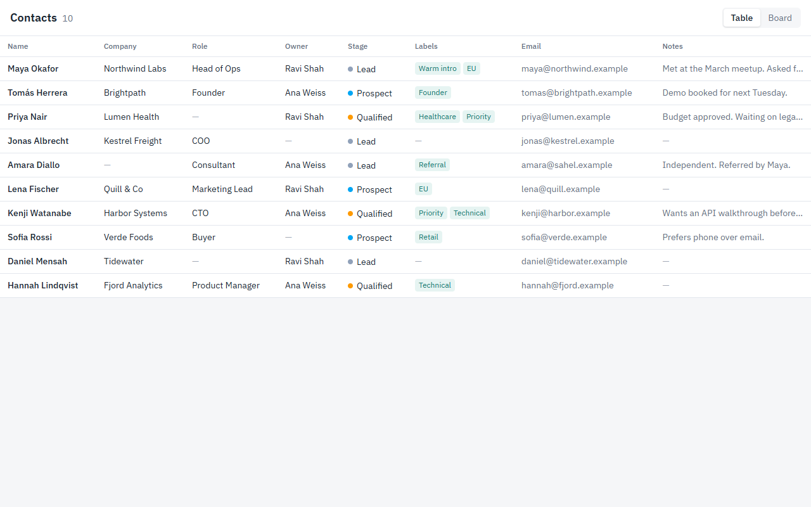
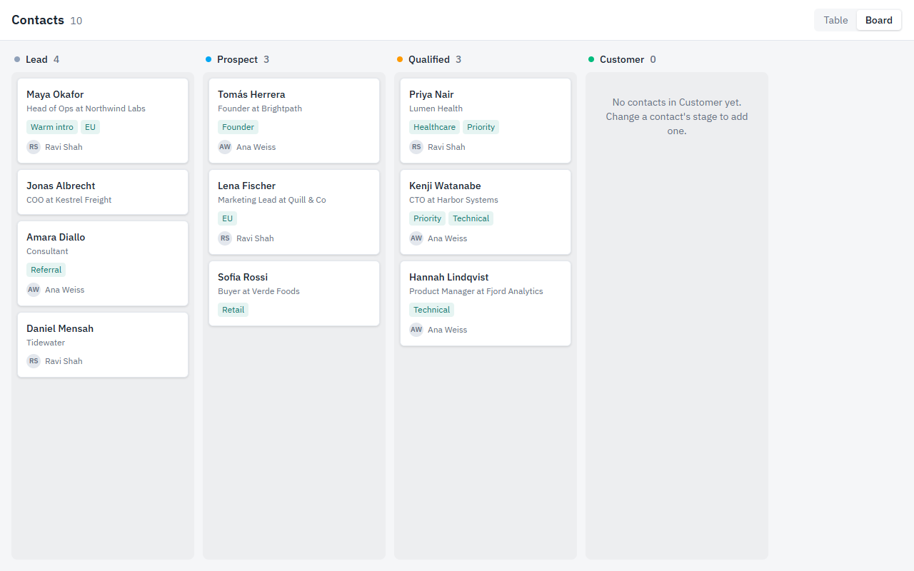

# Contacts: Table & Board Prototype

Live preview: https://contacts-prototype-five.vercel.app

A synchronized Table and Board interface built over a single dataset of 10 contacts. Built with React 19, TypeScript, Vite, and Tailwind CSS v4.





## Getting Started

```bash
npm install
npm run dev      # Local dev server at http://localhost:5173
npm run build    # TypeScript type-check + production bundle
```

## Core Functionality

- **Unified State Management**: Both Table and Board views subscribe to a single `contacts` state in `App.tsx`. Neither view maintains duplicate state, guaranteeing that pipeline updates remain 100% synchronized.
- **Dual-View Editing via Side Panel**: Clicking any contact card or table row slides open an editing drawer on the right. Edits to **Stage** and **Notes** are buffered in a local draft.
- **Controlled Mutations**: The **Save changes** button stays disabled until actual changes are detected. **Cancel**, pressing `Esc`, or clicking the close button discards pending edits.
- **Immediate Pipeline Reflection**: Saving a stage update moves the contact card to its new column on the board and updates the table row in the exact same render cycle.
- **Empty State Handling**: No contact begins in the "Customer" stage, displaying the empty group state immediately. Moving a contact into Customer dynamically populates the column.
- **Resilient to Incomplete Data**: Several mock records omit attributes (company, role, owner, tags, or notes). Missing fields are represented with clean, accessible dashes (`—`) rather than missing elements or awkward whitespace.
- **Focus Preservation**: Closing the side panel retains the user's active view and restores keyboard focus to the triggering row or card, even if the contact shifted columns.

## Design Decisions & Architectural Reasoning

- **Differentiating Table vs. Board**:
  - *Table View*: Optimized for scanning, dense comparison, and cross-referencing all contact attributes at a glance. To ensure ease of navigation on smaller viewports with horizontal overflow, the `Name` column is sticky-pinned to the left while other columns scroll beneath.
  - *Board View*: Geared for workflow triage and sales pipeline momentum. Cards surface only immediate decision-making context (name, role + company, tags, owner initials) to reduce visual cognitive load, leaving deeper notes and emails for the side panel.
- **Non-Modal Side Drawer**:
  - Rather than blocking user context with a modal backdrop, a persistent right-hand drawer was selected. This maintains visual continuity with the rest of the list or board while editing.
- **Explicit Save & Draft Buffering**:
  - Auto-saving on keystroke can cause accidental edits and jarring layout reorganizations (such as a card jumping columns mid-selection). By buffering edits in draft state and requiring an explicit save, changes remain intentional. An inline `role="status"` live region provides affirmative screen-reader feedback for saved states.
- **Visual System & Contrast**:
  - Built with a restrained neutral palette paired with a purposeful teal accent (`#0f766e`) and IBM Plex Sans typography. Stage indicators combine a color-coded dot with textual labels to avoid relying on color alone for accessibility (WCAG compliance).
- **Keyboard & Focus Flow**:
  - Contact names in the table and cards on the board are interactive `<button>` elements.
  - Opening the panel directs focus straight to its `<h2>` header.
  - Pressing `Escape` smoothly dismisses the panel and returns DOM focus back to the originating element using persistent `data-contact-id` selectors.

## Trade-offs & Technical Choices

- **Select Dropdown vs. Drag-and-Drop**:
  - Stage changes are driven by a standard `<select>` input in the drawer. While drag-and-drop provides direct tactile feedback, dropdown selection ensures bulletproof keyboard navigation, touch reliability, and zero risk of dropped/misplaced card states in a lightweight prototype.
- **Draft Discard Behavior**:
  - Navigating to another contact or dismissing the panel immediately discards uncommitted drafts. For this prototype scope, this keeps state simple and predictable; in a production CRM, a "Discard unsaved changes?" confirmation prompt would provide extra safety.
- **Scoped Editable Fields**:
  - Only Stage and Notes are mutable per the brief requirements. Metadata like Company, Role, Owner, and Labels are treated as read-only.
- **State Architecture**:
  - Managed via top-level React `useState`. For an expanded CRM application with asynchronous API persistence, optimistic UI updates, or bulk actions, transitioning to a `useReducer` or client cache (e.g. TanStack Query) would be the recommended next step.

## Next Steps / Future Enhancements

- Accessible drag-and-drop column transitions with keyboard reordering shortcuts.
- Full-text search, multi-attribute filtering (by Owner, Stage, or Tag), and sortable table columns.
- Prompt confirmation before discarding dirty drafts, plus an undo toast upon saving.
- Responsive transformation of the side panel into a full-screen modal sheet on mobile screens (<900px).
- Automated integration test suite covering view-switching and the save/cancel draft cycle.
